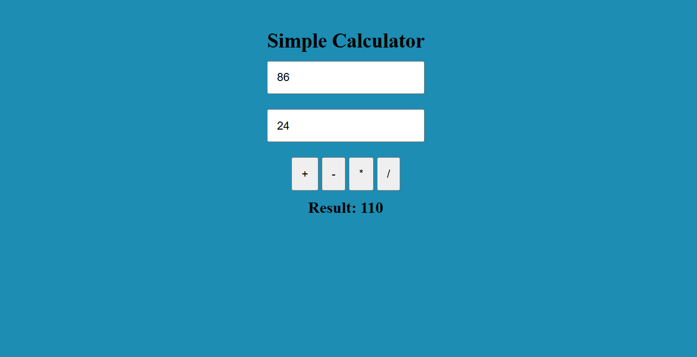

# Calculator
Ex.No:06 JavaScript Calculator
Date:26-11-2026
AIM
To design and develop a simple calculator using HTML, CSS, and JavaScript to perform basic arithmetic operations such as addition, subtraction, multiplication, and division.

ALGORITHM
Create an HTML page to design the calculator interface.
Create a display field to show the numbers and calculation results.
Create buttons for digits from 0 to 9 and arithmetic operators.
Use CSS to arrange and style the calculator buttons and display.
Write JavaScript functions to handle button clicks.
Store the entered numbers and operators in the calculator display.
Use JavaScript to evaluate the arithmetic expression.
Display the calculated result on the calculator screen.
Provide a clear button to reset the calculator.
Test the calculator with different arithmetic operations.
PROGRAM:
# HTML
<!DOCTYPE html>
<html>
<head>
    <title> Simple Calculator </title>
    <link href="style.css" rel="stylesheet">
</head>
<body>

<h2>Simple Calculator</h2>

<input type="number" id="n1" placeholder="Enter first number">
  

<input type="number" id="n2" placeholder="Enter second number">
  

<button onclick="calculate('+')">+</button>
<button onclick="calculate('-')">-</button>
<button onclick="calculate('*')">*</button>
<button onclick="calculate('/')">/</button>

<h3 id="result">Result:</h3>

</body>
</html>

# Style
*{
    margin: 0px;
    padding: 10px;
}
body{
    background-color: rgb(29, 141, 179);
}

OUTPUT:

RESULT
Thus, a JavaScript-based calculator was successfully designed and developed to perform basic arithmetic operations using HTML, CSS, and JavaScript.

RESULT
Thus, a JavaScript-based calculator was successfully designed and developed to perform basic arithmetic operations using HTML, CSS, and JavaScript.
